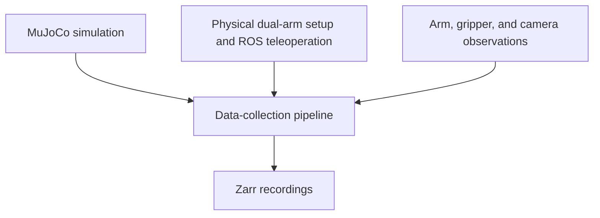

# Dual-Arm Robot Learning — Case Study

**Praxis Lab · Cornell University · Research Intern · June 2026–present**

I developed a pipeline for collecting demonstrations with a dual-arm xArm6 robot system. The pipeline brings together simulation, teleoperation, camera streams, and recording for imitation learning. I was invited to continue beyond the summer research program.

## My contributions

- Integrated MuJoCo simulation, ROS teleoperation, multi-camera streams, and Zarr recording.
- Adapted and debugged the recording software in simulation and on the physical robots.
- Worked on recording arm and gripper states alongside wrist-camera and external-camera streams.

## Pipeline overview

This diagram summarizes the components of the collection workflow.

My focus was getting the robot-state, gripper, and camera recording components to work together across simulation and hardware.

## Main components

| Component | Purpose |
| --- | --- |
| Dual xArm6 | Physical manipulation platform |
| MuJoCo | Simulation |
| ROS teleoperation | Operator control |
| Wrist and external cameras | Demonstration views |
| Zarr | Demonstration recording |

**About this repository:** This write-up describes my data-collection work at Praxis Lab. It does not include the lab's source code, datasets, or results from training a robot policy.

**Technologies:** Python, MuJoCo, ROS, xArm6, Zarr

[Back to my profile](https://github.com/emoryv)
