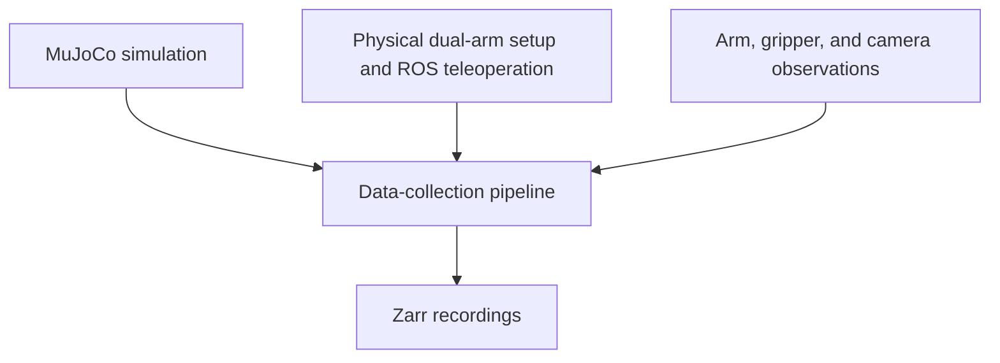

# Dual-Arm Robot Learning — Case Study

**Praxis Lab · Cornell University · Research Intern · June 2026–present**

Developed a data-collection pipeline for imitation learning with a dual-arm xArm6 system. The work connected simulation, robot teleoperation, multi-camera observations, and dataset recording. I was invited to continue beyond the summer research program.

## My contributions

- Integrated MuJoCo simulation, ROS teleoperation, multi-camera streams, and Zarr recording.
- Adapted and debugged the recording infrastructure across simulation and the physical-robot setup.
- Worked with arm states, gripper observations, wrist-camera streams, and external-camera streams.

## Pipeline overview

This diagram summarizes the components of the collection workflow.

The engineering focus was the connection between these components: making robot-state, gripper, and camera recording operate together so demonstrations could support imitation-learning research.

## Technical scope

| Component | Purpose |
| --- | --- |
| Dual xArm6 | Physical manipulation platform |
| MuJoCo | Simulation |
| ROS teleoperation | Operator control |
| Wrist and external cameras | Demonstration views |
| Zarr | Demonstration recording |

**Source availability:** This personal case study summarizes collaborative Praxis Lab work. Lab source code and datasets are not distributed here; the work described covers data collection, rather than evaluation of a learned policy.

**Technologies:** Python, MuJoCo, ROS, xArm6, Zarr

[Back to my profile](https://github.com/emoryv)
